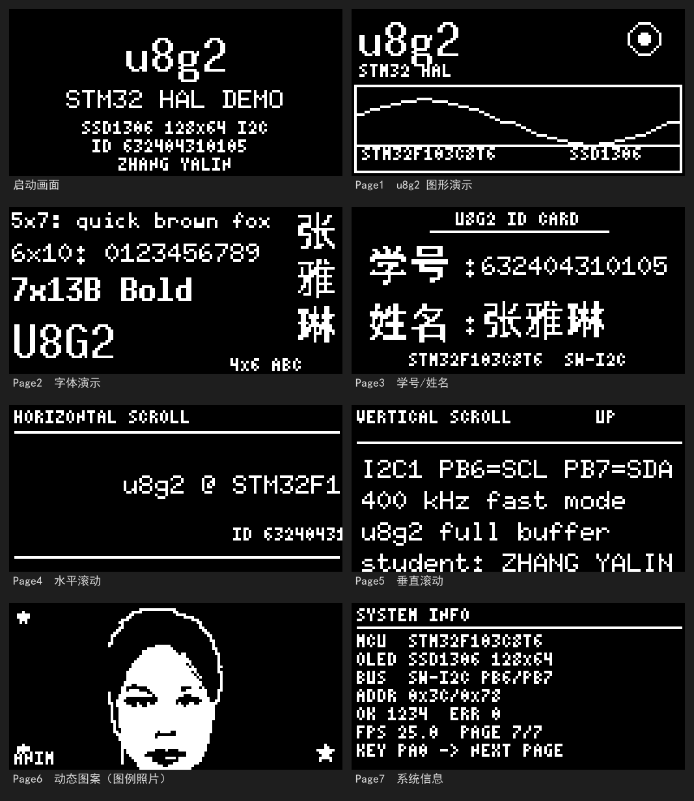

# 任务 3 设计报告：STM32F103 + HAL + u8g2 移植与 OLED 显示

**姓名：张雅琳　学号：632404310105　平台：STM32F103C8T6 + 0.96 寸 SSD1306 I2C OLED**

---

## 一、任务与完成情况

| 序号 | 任务 | 完成情况 | 对应实现 |
|---|---|---|---|
| 1 | 用 CubeMX 建立 HAL 库程序框架 | 完成 | `OLED_U28G.ioc`、`Core/`、`Drivers/`、`MDK-ARM/` |
| 2 | 下载并阅读 u8g2 源码 | 完成 | 阅读 `README.md`、`CMakeLists.txt`、`component.mk`、`SConscript`、`ChangeLog`、`LICENSE` 等 |
| 3 | 针对 STM32F103 + I2C OLED 裁剪 u8g2 | 完成 | 120 个源文件裁剪为 24 个 `.c` + 2 个 `.h`，字体 31 MB 裁剪为 5 个 |
| 4 | 移植到 HAL 程序 | 完成 | `App/Src/u8g2_port.c` 的 `u8x8` 字节回调 |
| 5 | u8g2 demo 例程 | 完成 | 第 1 页图形演示、第 2 页字体演示 |
| 6 | 显示学号姓名 | 完成 | 第 3 页：张雅琳 / 632404310105 |
| 7 | 掌握上下、左右滑动 | 完成 | 第 4 页左右跑马灯、第 5 页上下逐像素滚动、四方向翻页 |
| 8 | 显示带动态效果的图案 | 完成 | 第 6 页：3 帧呼吸缩放 + 摇摆 + 星星闪烁 |
| 9 | Keil 逻辑分析仪 I2C 波形分析 | 完成 | 本文第六节 |
| 10 | “显示 API 运行失败”分析 | 完成 | 本文第七节 + 第 7 页在线诊断 |

编译结果：**0 Error(s), 0 Warning(s)**；
`Code=15430  RO-data=13266  RW-data=116  ZI-data=3348`，
Flash 约 28.8 KB / 64 KB，RAM 约 3.4 KB / 20 KB。



---

## 二、CubeMX 工程框架设计

### 2.1 芯片与时钟

- 芯片：STM32F103C8Tx（LQFP48，64 KB Flash，20 KB SRAM，Cortex-M3）。
- 外部晶振：8 MHz（HSE）。
- PLL：HSE × 9 = 72 MHz；AHB = 72 MHz；APB1 = 36 MHz；APB2 = 72 MHz。
- Flash 等待周期：2（`FLASH_LATENCY_2`）。
- SysTick：1 ms，作为 `HAL_GetTick()` 和所有动画的时基。

### 2.2 引脚分配

| 引脚 | 功能 | 模式 | 说明 |
|---|---|---|---|
| PB6 | I2C1_SCL | 复用开漏 | OLED 时钟 |
| PB7 | I2C1_SDA | 复用开漏 | OLED 数据 |
| PA0 | GPIO_Input | 下拉 | WK_UP 按键，高有效，用于手动翻页 |
| PC13 | GPIO_Output | 推挽 | 板载 LED，低电平点亮，500 ms 心跳 |
| PA13/PA14 | SWDIO/SWCLK | Serial Wire | 下载调试 |
| PD0/PD1 | OSC_IN/OSC_OUT | HSE | 8 MHz 晶振 |

### 2.3 I2C1 参数

```c
hi2c1.Instance = I2C1;
hi2c1.Init.ClockSpeed = 400000;          /* 400 kHz 快速模式 */
hi2c1.Init.DutyCycle = I2C_DUTYCYCLE_2;
hi2c1.Init.OwnAddress1 = 0;
hi2c1.Init.AddressingMode = I2C_ADDRESSINGMODE_7BIT;
hi2c1.Init.DualAddressMode = I2C_DUALADDRESS_DISABLE;
hi2c1.Init.GeneralCallMode = I2C_GENERALCALL_DISABLE;
hi2c1.Init.NoStretchMode = I2C_NOSTRETCH_DISABLE;
```

`HAL_I2C_MspInit()` 中把 PB6/PB7 配成 `GPIO_MODE_AF_OD`、`GPIO_SPEED_FREQ_HIGH`，
并打开 GPIOB 和 I2C1 时钟。OLED 模块自带上拉时无需外接；没有上拉时必须外加
4.7 kΩ 到 3.3 V。

### 2.4 CubeMX 生成设置

| 选项 | 值 |
|---|---|
| Project Name | OLED_U28G |
| Toolchain | MDK-ARM V5 |
| Firmware Package | STM32Cube FW_F1 V1.8.7 |
| Application Structure | Advanced |
| Code Generator | 复制必要库文件；保留用户代码 |
| 堆 / 栈 | 0x200 / 0x400 |

生成后只在 `USER CODE` 区域加入应用代码，因此以后在 CubeMX 里改引脚、改时钟，
重新生成也不会丢掉 `App_Init()` / `App_Task()`。

### 2.5 程序总体结构

```text
main()
 ├─ HAL_Init()
 ├─ SystemClock_Config()
 ├─ MX_GPIO_Init()
 ├─ MX_I2C1_Init()
 ├─ App_Init()                 // u8g2 初始化、扫描地址、启动画面
 └─ while (1) App_Task()       // 非阻塞状态机：按键、翻页、动画、送显
```

`App_Task()` 不做 `HAL_Delay` 长等待，所有节奏由 `HAL_GetTick()` 控制，
因此按键响应、动画和 I2C 传输可以同时进行。

---

## 三、u8g2 源码阅读与裁剪

### 3.1 仓库里各个文件是做什么的

| 文件 | 结论 |
|---|---|
| `README.md` | u8g2 是单色图形库，支持 SSD1306 等控制器；分 u8g2（带显存、图形）和 u8x8（纯文本、无显存）两层 |
| `CMakeLists.txt` | 列出全部 90 多个 `csrc/*.c`，是通用构建脚本，不适合直接拿来编译 STM32 工程 |
| `component.mk` | ESP-IDF 组件描述，只有两行，与本任务无关 |
| `SConscript` | RT-Thread 的构建桥，转到 `sys/rt-thread/SConscript`，与本任务无关 |
| `.gitignore` | 只忽略 `*.o` 和 `*.~`，说明仓库本身很干净 |
| `.gitmodules` | 只有一个 `sys/arm-linux/c-periphery` 子模块，用于 Linux 用户态 I2C |
| `.gitpod.yml` / `.gitpod.Dockerfile` | Gitpod 在线开发环境，`cmake .` 初始化，与 STM32 无关 |
| `ChangeLog` | 版本约 v2.33.x；可确认 API 与网上教程一致 |
| `LICENSE` | BSD 2-Clause，允许裁剪和商用，但必须保留版权声明 |

另外查看了 `csrc/` 和 `sys/`：`sys/` 下有 Arduino、AVR、Linux、SDL、RT-Thread 等示例，
**没有 STM32 HAL 的现成移植**，所以需要自己实现 `u8x8` 的字节收发回调。

### 3.2 为什么必须裁剪

原始 `csrc/`：

- 文件总数 120 个；
- `u8g2_fonts.c` 约 **31 MB**（包含上千种字体）；
- `u8g2_d_setup.c` 约 **372 KB**（所有显示屏的初始化函数）；
- 如果整个加入 Keil 工程，`.o` 文件和最终镜像会远超 64 KB Flash。

裁剪目标：只保留 **SSD1306 128×64 I2C + 全屏缓存 + 5 个小字体** 所需的最小集合。

### 3.3 裁剪清单

| 功能 | 保留文件 | 说明 |
|---|---|---|
| u8g2 核心 | `u8g2_setup.c` `u8g2_buffer.c` `u8g2_hvline.c` `u8g2_ll_hvline.c` `u8g2_intersection.c` `u8g2_font.c` `u8g2_kerning.c` `u8g2_cleardisplay.c` | 初始化、显存、水平/垂直线、裁剪、字体渲染 |
| 图形 | `u8g2_bitmap.c` `u8g2_box.c` `u8g2_line.c` `u8g2_circle.c` `u8g2_polygon.c` | 画点、框、线、圆、多边形 |
| u8x8 | `u8x8_setup.c` `u8x8_display.c` `u8x8_byte.c` `u8x8_cad.c` `u8x8_gpio.c` `u8x8_8x8.c` `u8x8_capture.c` `u8x8_u16toa.c` | 底层传输、命令/数据打包、UTF-8 辅助 |
| 显示屏 | `u8x8_d_ssd1306_128x64_noname.c` | 只留 SSD1306 128×64 |
| 初始化 | 重写 `u8g2_d_setup.c` | 只保留 `u8g2_Setup_ssd1306_i2c_128x64_noname_1/_2/_f` |
| 显存 | 重写 `u8g2_d_memory.c` | 只保留 `u8g2_m_16_8_1/_2/_f`（128/256/1024 字节） |
| 字体 | 重写 `u8g2_fonts.c` | `4x6_tf`、`5x7_tf`、`6x10_tf`、`7x13B_tf`、`10x20_tf` |
| 头文件 | `u8g2.h` `u8x8.h` | 未修改 |

### 3.4 裁剪脚本

`Tools/trim_u8g2.py` 做三件事：

1. 从原仓库 `csrc/` 复制白名单文件；
2. 用正则找出 `u8g2_d_setup.c` 中三个 `noname` 初始化函数，拼成新的 `u8g2_d_setup.c`；
3. 按 `const uint8_t u8g2_font_xxx[` 分块，只保留 5 个字体，生成新的 `u8g2_fonts.c`。

字体裁剪后的源码只有约 30 KB，编译进镜像的字体数据约 8 KB。

### 3.5 显存模式选择

u8g2 的 `_1` / `_2` / `_f` 分别对应 1 页、2 页、全屏（8 页）缓存：

- `_1`：128 字节缓存，只能画 8 行高的窗口，适合纯文本；
- `_f`：1024 字节缓存，可以任意画点、画线、做整屏动画；
- 本项目需要图形、滑动和图片，选择 `_f`。

代价是 1 KB RAM，F103C8 有 20 KB，完全够用。

---

## 四、移植到 HAL

### 4.1 调用链

```text
page_xxx()
  → u8g2_DrawStr / DrawLine / DrawXBMP / SendBuffer
    → u8g2 核心（1024 字节 tile buffer）
      → u8x8_cad_ssd13xx_fast_i2c()   // 自动插入 0x00/0x40 控制字节，24 字节分块
        → u8x8_byte_stm32_hw_i2c()    // 本项目实现
          → HAL_I2C_Master_Transmit(&hi2c1, addr, buf, len, 20)
```

### 4.2 字节回调

```c
uint8_t u8x8_byte_stm32_hw_i2c(u8x8_t *u8x8, uint8_t msg, uint8_t arg_int, void *arg_ptr)
{
    uint8_t *p = (uint8_t *)arg_ptr;

    switch (msg)
    {
    case U8X8_MSG_BYTE_INIT:
    case U8X8_MSG_BYTE_START_TRANSFER:
        i2c_tx_len = 0;
        return 1;

    case U8X8_MSG_BYTE_SEND:
        while (arg_int--) i2c_tx_buf[i2c_tx_len++] = *p++;
        return 1;

    case U8X8_MSG_BYTE_END_TRANSFER:
        if (HAL_I2C_Master_Transmit(&hi2c1, g_oled_addr,
                                    i2c_tx_buf, i2c_tx_len, 20) != HAL_OK)
        {
            g_i2c_err_count++;
            return 0;
        }
        g_i2c_ok_count++;
        return 1;
    }
}
```

要点：

- **不需要手动加地址**：HAL 的 `DevAddress` 参数就是 8 位地址（0x78），
  缓冲区里是控制字节 + 数据。
- u8g2 的 CAD 层已经把长数据拆成 ≤24 字节的块，所以 64 字节缓冲足够。
- 超时设为 20 ms，避免屏幕没接时每帧卡 100 ms。

### 4.3 延时回调

```c
case U8X8_MSG_DELAY_MILLI:   HAL_Delay(arg_int);              break;
case U8X8_MSG_DELAY_10MICRO: delay_us(arg_int * 10);          break;
case U8X8_MSG_DELAY_100NANO: __NOP();                         break;
```

`delay_us()` 优先用 DWT 周期计数器，未使能时退化为 `__NOP()` 循环，
保证在 Keil 仿真和真实硬件上都不会死等。

### 4.4 初始化与地址扫描

```c
u8g2_Setup_ssd1306_i2c_128x64_noname_f(&u8g2, U8G2_R0,
                                       u8x8_byte_stm32_hw_i2c,
                                       u8x8_gpio_and_delay_stm32);
u8x8_SetI2CAddress(&u8g2.u8x8, g_oled_addr);
u8g2_InitDisplay(&u8g2);
u8g2_SetPowerSave(&u8g2, 0);
u8g2_ClearBuffer(&u8g2);
u8g2_SendBuffer(&u8g2);
```

顺序不能反：**先 Setup，再 SetI2CAddress，再 InitDisplay，最后开显示**。
`U8G2_Port_Scan()` 会依次探测 0x78 和 0x7A，兼容 0x3C/0x3D 两种模块。

### 4.5 总线恢复

如果传输过程中从机把 SDA 拉低，HAL 会一直 `HAL_BUSY`。恢复流程：

1. `HAL_I2C_DeInit()`；
2. 把 PB6/PB7 配成普通开漏输出；
3. SCL 输出 9 个时钟，让从机吐完当前字节；
4. 手动产生 STOP（SCL 高时 SDA 由低变高）；
5. 重新 `MX_I2C1_Init()`。

扫描失败时自动执行一次；运行中 `ERR` 持续增长也可以调用。

---

## 五、显示功能实现

### 5.1 u8g2 demo（第 1、2 页）

第 1 页综合使用：

- `u8g2_DrawStr`：10×20 的 “u8g2” 标志；
- `u8g2_DrawFrame`：边框；
- `u8g2_DrawCircle` / `u8g2_DrawDisc`：右上角脉动圆；
- `u8g2_DrawLine`：正弦曲线，相位随时间变化；
- 4×6 字体显示芯片型号。

正弦值不用浮点，用 64 点 `int8_t sin_tab[]` 查表，节省 Flash 和 CPU。

第 2 页依次显示 5×7、6×10、7×13B、10×20、4×6 五种字体，
右侧竖排显示 16×16 的“张雅琳”三个汉字，验证 ASCII 与自定义汉字混排。

### 5.2 学号姓名（第 3 页）

u8g2 自带字体没有汉字。完整 GB2312 字库要几十 KB，因此采用**按需点阵**：

- 用 SimHei 16 px 生成 7 个字的 16×16 点阵：张、雅、琳、学、号、姓、名；
- 每个字 32 字节，共 224 字节；
- 以 Unicode 码点建表，`CnFont_Draw()` 查表后调用 `u8g2_DrawXBMP()`。

版式：

```text
        U8G2 ID CARD
        ───────────
学号 : 632404310105
姓名 : 张雅琳
   STM32F103C8T6  I2C1 400kHz
```

### 5.3 左右滑动（第 4 页）

两行跑马灯：6×10 字体 2 px/帧，4×6 字体 1 px/帧。

关键问题是 **u8g2 的坐标类型是无符号的**（默认 `uint8_t`），
`u8g2_DrawStr(-3, ...)` 会被当成 253，直接不画。因此：

```c
x = 128 - pos;
if (x >= 0) {
    u8g2_DrawStr(&u8g2, x, y, text);
} else {
    int skip = (pos + 5) / 6;              // 跳到下一个字符边界
    u8g2_DrawStr(&u8g2, skip*6 - pos, y, text + skip);
}
```

这样文本可以无限循环，且坐标始终非负。代价是左边界按字符（6 px）跳变，
在 0.96 寸屏上肉眼几乎看不出。

### 5.4 上下滑动（第 5 页）

全屏缓存布局是 8 页 × 128 字节，每字节是纵向 8 个像素。利用这个布局，
垂直滚动不需要重画文本，只要对缓冲区做位运算：

```c
/* 上移 n 像素：新 bit k = 旧 bit k+n，低位从下一页借 */
lo = buf[page*128 + x] >> n;
hi = (page < 7) ? buf[(page+1)*128 + x] << (8-n) : 0;
buf[page*128 + x] = lo | hi;
```

流程：

1. 每帧 `lcd_shift_up(1)` 或 `lcd_shift_down(1)`；
2. 只重画“顶部坐标 ≥ 0”的行（已经滚出顶部的部分保留在缓冲区里）；
3. 顶部 16 行用不透明标题栏覆盖；
4. 滚到末尾自动反向，于是能看到“向上滚”和“向下滚”两种效果。

由于滚动页不每帧 `ClearBuffer`，所以 `render_now()` 对第 5 页使用
`g_keep` 标志保留缓冲区；离开该页时再恢复正常清屏。

### 5.5 四方向滑动翻页

普通翻页如果直接切换会显得生硬。这里做了 420 ms 的滑动动画：

- 左：旧页不动，新页从右侧进入；
- 上：旧页不动，新页从底部进入；
- 右：新页在底层，旧页向右滑出；
- 下：新页在底层，旧页向下滑出。

“右/下”方向如果直接画负坐标会失败，所以采用**先画新页、再用黑色填充清出
旧页要占的区域、最后把旧页画在正偏移处**的方法，效果等价且全部坐标非负。

页面切换顺序按 左 → 上 → 右 → 下 轮换，10 s 自动一次，按 PA0 立即切换。

### 5.6 动态图案（第 6 页）

素材是工程根目录的 `图例.jpg`（张雅琳的蓝底证件照）。

处理步骤（`Tools/generate_assets.py`）：

1. 取头像区域（完整头部 + 少量肩部），去掉四周多余背景；
2. 用“蓝色分量明显高于红/绿且整体较亮”的判据识别蓝底并置黑；
3. 转灰度、自动对比度、按 48×64 缩放（保持人脸比例），居中放进 64×64 画布；
4. 阈值 185 二值化，得到白脸、黑发、黑眼睛/嘴唇的单色图；
5. 沿人物轮廓补一圈白线（否则黑发会和黑色背景融为一体），并跳过图像边缘避免出现方框；
6. 分别裁掉 0 / 24 / 48 像素再缩放，得到 3 帧“由远到近”的呼吸效果；
7. 按 u8g2 XBMP 格式（LSB 在前、每行按字节对齐）输出 C 数组。

播放：

```c
uint8_t seq = (HAL_GetTick() / 260) % 4;   // 0,1,2,1 循环
frame = (seq == 3) ? 1 : seq;
sway  = sin_tab[(HAL_GetTick()/50) & 63] * 5 / 100;   // ±5 px 摇摆
u8g2_DrawXBMP(&u8g2, 32 + sway, 0, 64, 64, duck_frames[frame]);
```

再叠加四角星星：7×7 与 9×9 两档、按相位闪烁，形成“呼吸 + 摇摆 + 星光”的
动态效果。整页约 1.5 KB 图片数据 + 200 字节代码。

---

## 六、Keil 虚拟逻辑分析仪与 I2C 波形

### 6.1 正常 I2C 写时序

一次“写命令”事务：

```text
START | 0x78 | ACK | 0x00 | ACK | CMD | ACK | STOP
```

一次“写显存”事务：

```text
START | 0x78 | ACK | 0x40 | ACK | D0 | ACK | D1 | ACK | ... | D127 | ACK | STOP
```

位级波形（以 0x78 + 0x00 + 0xAF 为例，A6…A0 为地址位，W=0）：

```text
 SDA  ─┐  ┌──┬──┬──┬──┬──┬──┬──┬──┬──┬──┬──┬──┬──┬──┬──┬──┐  ┌──
       └──┘  A6 A5 A4 A3 A2 A1 A0 W  ACK D7 D6 D5 D4 D3 D2 D1 D0 ACK ...
 SCL  ───┐ ┌┐ ┌┐ ┌┐ ┌┐ ┌┐ ┌┐ ┌┐ ┌┐ ┌┐ ┌┐ ┌┐ ┌┐ ┌┐ ┌┐ ┌┐ ┌┐ ┌┐ ┌┐ ┌┐
         └─┘└─┘└─┘└─┘└─┘└─┘└─┘└─┘└─┘└─┘└─┘└─┘└─┘└─┘└─┘└─┘└─┘└─┘└─┘
          S           地址 0x78（0x3C<<1）          命令 0xAF
```

- START：SCL 为高时 SDA 下降；
- STOP：SCL 为高时 SDA 上升；
- 数据 MSB 先发，第 9 个时钟从机拉低 SDA 表示 ACK；
- 0x78 的二进制是 `0111 1000`，示波器上应能看到这 8 位。

### 6.2 400 kHz 下的时间参数

| 参数 | 数值 |
|---|---|
| SCL 周期 | 2.5 µs |
| SCL 高电平 | ≥ 0.6 µs（本项目占空比 1/2，约 1.25 µs） |
| SCL 低电平 | ≥ 1.3 µs |
| 上升时间 | ≤ 300 ns（4.7 kΩ 上拉） |
| 一个字节（含 ACK） | 9 个时钟 ≈ 22.5 µs |
| 128 字节一页 | 约 2.9 ms |
| 整屏 8 页 | 约 23 ms（加软件开销约 30 ms） |

所以第 7 页显示的 FPS 大约 25～30，与理论一致。

### 6.3 为什么 Keil 的逻辑分析仪抓不到

Keil 官方《Logic Analyzer Restrictions》明确说明：

> I/O pin toggling of UART, CAN, SPI, or I²C communication peripherals is not simulated.

即 **UART、CAN、SPI、I²C 等通信外设的 I/O 引脚翻转不会被仿真**，具体表现为：

1. **仿真器不模拟 I2C 外设**  
   即使代码在调用 `HAL_I2C_Master_Transmit`，I2C 移位寄存器也不会把 `0x78`、`0x00`、
   数据一位一位地推到 PB6/PB7 上，所以 SDA/SCL 是直线。

2. **逻辑分析仪没有协议解码**  
   Keil 的 Logic Analyzer 只是“数字波形查看器”，可以显示引脚高低，
   但不会标注 START/地址/ACK/STOP，也不能像 PulseView 那样一键解 I2C。

3. **仿真时间不等于真实时间**  
   即使改用软件 I2C 能看到波形，仿真器按指令周期推进，波形的时间轴和真实
   400 kHz 并不一致，不能用来验证时序余量。

> 参考：<https://www.keil.com/support/man/docs/uv4cl/uv4cl_db_dbg_logicanalyzer_restrictions.htm>

### 6.4 可以改用的方法

| 方案 | 具体做法 | 能验证什么 | 成本 |
|---|---|---|---|
| ① 软件 I2C + Keil 逻辑分析仪 | 工程默认 `OLED_USE_SW_I2C=1`，Logic Analyzer 添加 `PORTB.6`、`PORTB.7` | 起始/停止、地址位、数据位（ACK 位因无从机而为高） | 0 元，本项目已实现 |
| ② USB 逻辑分析仪 | Saleae Logic / DSLogic / LA1010，配 PulseView 的 I2C 解码器 | 完整协议、真实 ACK、时序、错误帧 | 几十到几百元 |
| ③ 示波器 | 双通道看 SCL/SDA，触发 START | 电平、上升沿、毛刺、上拉是否合适 | 实验室已有 |
| ④ 第二块 MCU 嗅探 | 一块 F103/Arduino 用 GPIO 采样或 I2C 从机模式，UART 上传 | 长时间抓包、统计错误 | 一块开发板 |
| ⑤ Proteus / SimulIDE / Wokwi | 搭建 F103 + SSD1306 仿真 | 协议和显示效果 | 软件免费 |
| ⑥ 固件自诊断 | 统计 `HAL_I2C_Master_Transmit` 返回值，翻转调试 IO，UART/SWO 打印 | 是否成功、错误码、重试次数 | 0 元 |

### 6.5 用软件 I2C 在 Keil 里看波形的步骤

1. 工程默认已经是 `OLED_USE_SW_I2C=1`（见 `App/Inc/app_config.h`），直接 `Rebuild`；
   若要跑硬件 I2C 400 kHz，把它改成 `0` 再编译。
2. 进入 Debug（`Use Simulator`）；
3. `View → Analysis Windows → Logic Analyzer`；
4. 在 `Setup` 里添加 `PORTB.6`（SCL）和 `PORTB.7`（SDA），Display Type 选 `Bit`，
   采样率设为 10 MHz；
5. 全速运行 1～2 秒，暂停后即可看到 9 个时钟一组的波形；
6. 按 6.1 的位序人工解码，或用 `File → Save` 导出后用 Python/sigrok 解码。

> 软件 I2C 的 `SW_I2C_Init()` 把 PB6/PB7 配成开漏输出，用 NOP 循环产生
> 约 150 kHz 的时钟；读 ACK 时先释放 SDA，再读 IDR。`main.c` 在软件 I2C 模式下
> 会跳过 `MX_I2C1_Init()`，避免仿真器卡在 HAL 的 I2C 初始化里。  
> 仿真里没有 OLED 从机，**ACK 位会保持高电平**，这是正常现象；真实硬件才会拉低。  
> 若输入 `PORTB.6` 提示信号不存在，把 Debug → Simulator 的 Dialog DLL 改为
> `DARMSTM.DLL`、参数 `-pSTM32F103C8`。

---

## 七、“显示 API 运行失败”的原因与处理

> 先区分语境：如果是网页/接口调用报“API 运行失败”，属于会话侧临时故障，
> 刷新或重发即可；下面分析的是 **OLED 显示相关 API 调用失败**。

### 7.1 常见原因速查

| # | 原因 | 现象 | 解决 |
|---|---|---|---|
| 1 | I2C 地址错：7 位 0x3C 当成 8 位用，或模块是 0x3D | `HAL_ERROR`，全黑 | 用 0x78/0x7A 扫描；本工程已自动扫描 |
| 2 | 没初始化 I2C 就调用 u8g2 | 第一次传输就失败 | 先 `MX_I2C1_Init()`，再 `U8G2_Port_Init()` |
| 3 | 初始化顺序错 | 有背光无内容 | Setup → SetI2CAddress → InitDisplay → SetPowerSave(0) |
| 4 | 忘记 `SendBuffer` | 显存有内容但屏不变 | 每帧结束 `u8g2_SendBuffer()` |
| 5 | 选错 Setup 函数 | 无反应/花屏 | I2C 屏必须用 `..._i2c_...`，不能用 `..._8080_...` |
| 6 | 缓冲区不够 | HardFault 或花屏 | `_f` 需要 1024 字节，本工程用静态数组 |
| 7 | 栈太小 / 局部大数组 | 随机死机 | 栈 0x400；大数组放静态区 |
| 8 | 上拉不足 / 线太长 | 随机 NACK、花屏 | 4.7 kΩ 上拉，缩短杜邦线，降到 100 kHz |
| 9 | SDA 被从机拉死 | `HAL_BUSY`，卡住 | 9 个时钟 + STOP 恢复（已实现） |
| 10 | 汉字用 `DrawStr` 显示 | 乱码/空白 | 用 XBMP 字库 `CnFont_Draw` |
| 11 | 源文件编码不是 UTF-8 | 中文注释乱码、编译警告 | 本工程所有 `.c/.h` 都是纯 ASCII |
| 12 | Keil 仿真里不显示 | 仿真无 I2C 模型 | 用软件 I2C 或真实硬件（见第六节） |

### 7.2 本项目内置的防护

- 上电自动扫描 0x78/0x7A，找不到就执行总线恢复再扫一次；
- 每次传输统计成功/失败次数，第 7 页实时显示；
- 找不到屏幕时每 2 s 重试初始化，插上屏幕后自动恢复；
- 传输超时 20 ms，避免“屏幕没接导致程序像死机”；
- 所有绘制函数对 `x<0 / y<0` 做保护（u8g2 坐标是无符号的）。

### 7.3 调试建议顺序

1. 先看第 7 页 `ADDR` 是否为你模块的地址，`ERR` 是否为 0；
2. 用万用表确认 OLED VCC = 3.3 V、GND 共地；
3. 用 `HAL_I2C_IsDeviceReady()` 单独测试地址；
4. 降低 I2C 速率到 100 kHz 再试；
5. 换一块已知正常的 OLED 模块，排除屏本身问题；
6. 用软件 I2C 版本排除 STM32 I2C 外设/GPIO 复用问题；
7. 最后再怀疑 u8g2 的 Setup 函数和缓冲区。

---

## 八、测试与结果

### 8.1 编译

Keil MDK 5 + ARMCC V5.06：

```text
Build target 'OLED_U28G'
Program Size: Code=15430  RO-data=13266  RW-data=116  ZI-data=3348
"OLED_U28G\OLED_U28G.axf" - 0 Error(s), 0 Warning(s).
```

### 8.2 PC 端渲染验证

为了在没有 OLED 的情况下检查排版，`Tools/sim/` 用 MinGW 把**真实的**
`app_ui.c`、`cn_font.c`、`duck_anim.c` 和 u8g2 源码编译成 PC 程序，
用假的 HAL 函数提供时基，直接导出 128×64 帧缓冲为 PGM，再转成 PNG。

验证内容：

- 启动画面 5 行文字不重叠；
- 第 1 页正弦波、圆、边框位置正确；
- 第 2 页 5 种字体和 3 个汉字都在屏内；
- 第 3 页学号 12 位完整、姓名三字完整；
- 第 4 页两行跑马灯可循环；
- 第 5 页上下滚动到边界自动反向；
- 第 6 页 3 帧呼吸 + 星星闪烁；
- 第 7 页诊断信息完整。

预览图见 `Docs/UI预览.png`。

### 8.3 实物调试步骤

1. 用 ST-Link 下载，复位后先看启动画面；
2. 若黑屏，看 PC13 是否 500 ms 闪烁（说明程序在跑）；
3. 按 PA0 能翻页说明按键正常；
4. 观察第 7 页 `ERR` 是否为 0；
5. 用手机慢动作拍第 6 页，可清楚看到呼吸和星光变化。

### 8.4 可继续改进

- 用 DMA + 局部刷新（`u8g2_UpdateDisplayArea`）把帧率提到 40 FPS 以上；
- 增加按键菜单，手动选择页面和滚动方向；
- 把汉字字库扩展到完整 GB2312（需外挂 SPI Flash）；
- 用 RLE 压缩图片，腾出 Flash 放更多动画帧；
- 增加 SHT30 温湿度页（参考同目录其他工程）。

---

## 九、参考资料

1. u8g2 官方仓库：<https://github.com/olikraus/u8g2>
2. u8g2 Wiki：<https://github.com/olikraus/u8g2/wiki>
3. SSD1306 datasheet（128×64，I2C 地址 0x3C/0x3D）
4. STM32F103x8/xB datasheet 与 RM0008 参考手册
5. STM32CubeMX 6.17 / STM32Cube FW_F1 V1.8.7
6. Keil MDK 5 用户手册（Logic Analyzer / Simulator 章节）
