# STM32 OLED底层驱动与U8G2移植实战

[toc]

## 0 前言

本次博文带大家通过I2C协议连接STM32与OLED，OLED接收I2C总线上的数据来展示学号姓名、SHT30温湿度读取以及长字符滑动。其次了解掌握移植U8g2图形库的方法，实现绘图、文字滑动与图案动画，其中探究Keil虚拟逻辑分析仪I2C波形问题与解决方法。

## 1 介绍原理

### 1.1 认识I2C通信

I2C是一种半双工同步串行通信总线，通信依靠两根信号线完成。其中SCL为串行时钟线，由主机 STM32 提供同步时钟。SDA为串行数据线，支持双向收发数据。I2C总线支持挂载多个外设，依靠 7 位从机地址完成设备区分。如下图为I2C串行通信总线图。

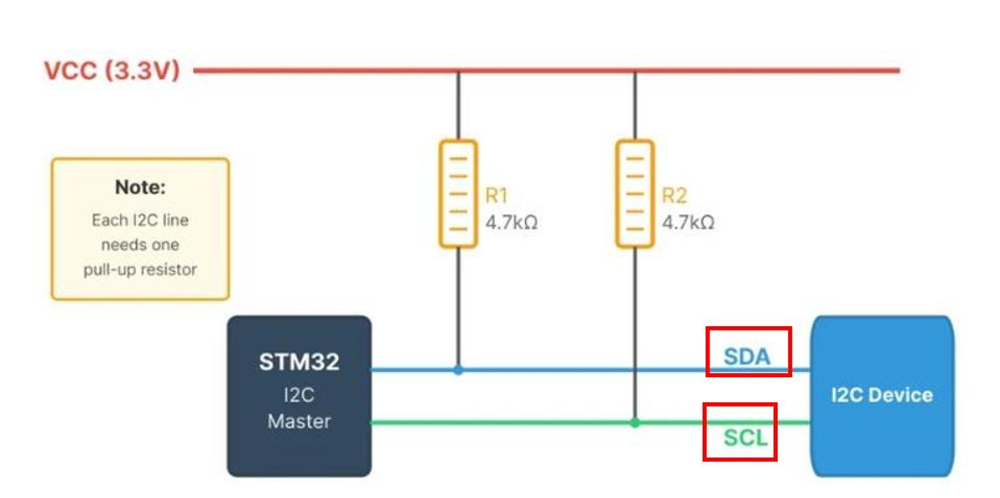

总线空闲状态下，SCL、SDA 依靠外部上拉电阻维持高电平。起始信号S定义为SCL保持高电平时，SDA由高电平跳变为低电平；停止信号P定义为SCL保持高电平时，SDA由低电平跳变为高电平。每传输完1字节共8位数据后，接收方会拉低SDA一个时钟周期作为应答信号，若无应答则代表从机未正常响应主机。

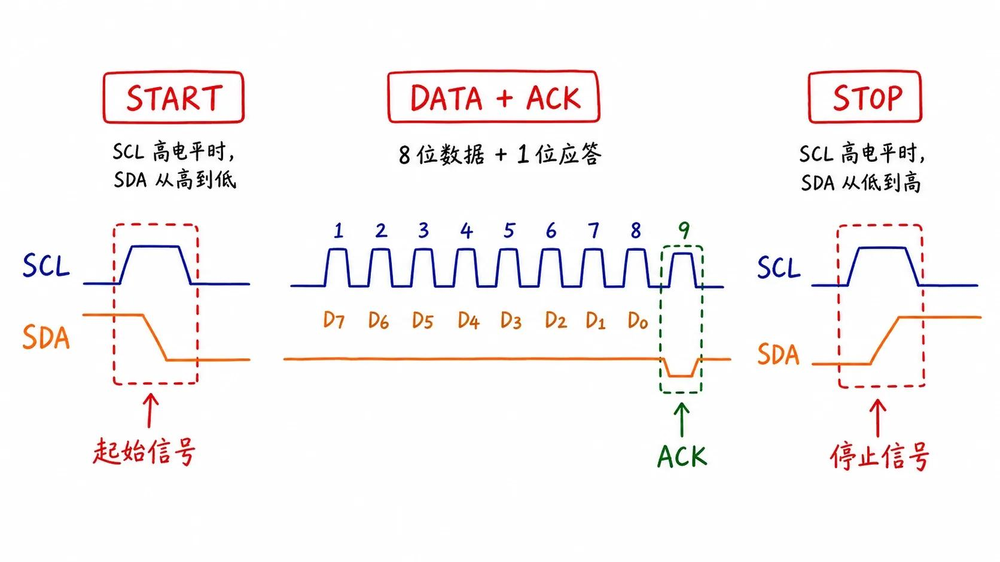

本实验我采用两路独立硬件I2C外设。I2C1 挂载SSD1306驱动的OLED屏幕，I2C2挂载SHT30温湿度传感器，两组总线相互独立。

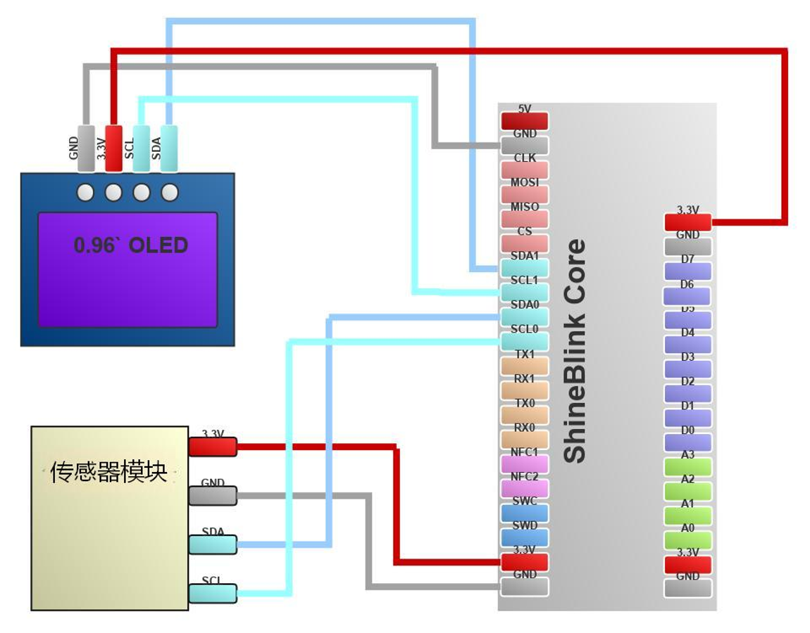

## 1.2OLED屏显汉字点阵编码

OLED屏中SSD1306控制器将显存划分为8个页，每页8行像素，总显存 128×8 字节；通过I2C通信区分0x00命令与0x40显示数据。屏幕为单色点阵，控制一个像素，实验16×16 点阵显示汉字，单字占 32字节。而数字的显示需要用到PCtoLCD2002 取模，将点阵数组写入显存实现汉字显示。SSD1306带硬件滚动寄存器，配置后可由屏内控制器自主完成字幕滚动。

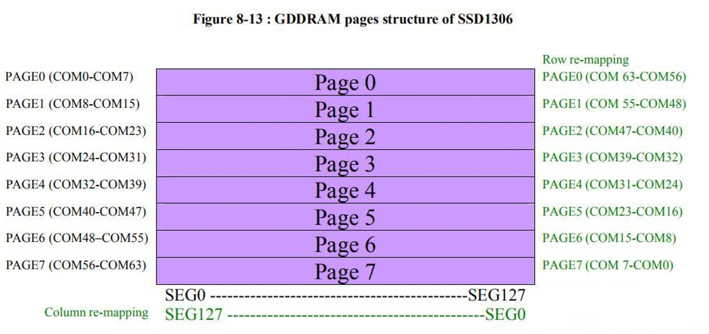

## 1.3 SHT30 温湿度传感器原理

实验我采用SHT30温湿度传感器。该流程为主机下发测量指令，等待传感器完成模数转换，随后读取6字节返回数据，数据依次为湿度高字节、湿度低字节、湿度CRC校验字节、温度高字节、温度低字节、温度CRC校验字节。CRC校验机制用于校验传输数据，降低总线干扰带来的数据出错概率。

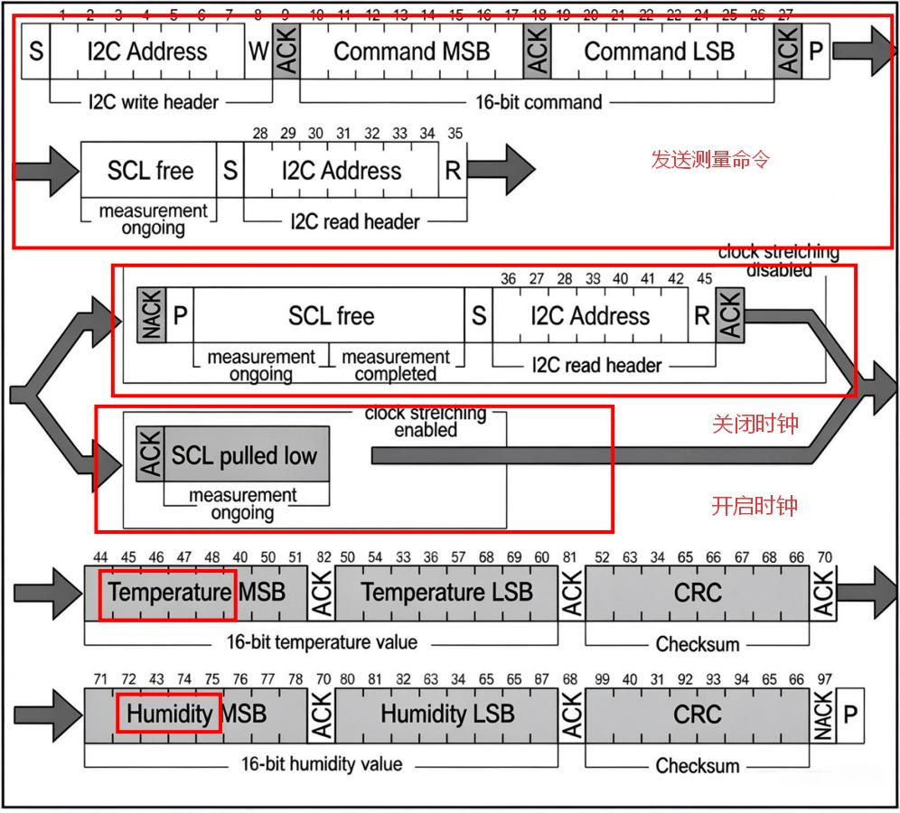

### 1.4u8g2移植

U8G2 是开源单色屏图形库，提供绘图、文字、等API如下图所示。库自带大量屏幕与接口驱动，源码庞大，移植时需要裁剪，保留SSD1306 I2C相关驱动与所需字体。编写 底层回调函数，对接 STM32 HAL库 I2C接口。绘图时先在MCU内部显存完成绘制，再调用刷新函数整屏下发数据到 OLED。

U8G2 的字幕滑动依靠 CPU 修改图像坐标、反复刷新显存实现。图案动态效果则通过循环修改点阵绘制坐标、定时刷新实现。依次完成 Demo 测试、学号姓名显示、多方向滑动、肖像图案动态展示。

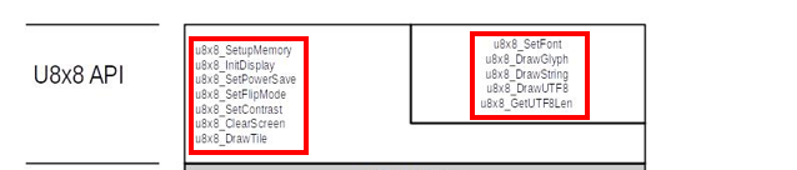

## 2 OLED信息显示与滑动

:red_circle:STM32CubeMX外设配置

:large_blue_diamond:选择STM32F103芯片，配置好RCC与SYS基础配置

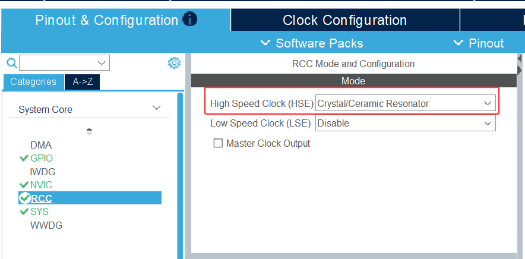

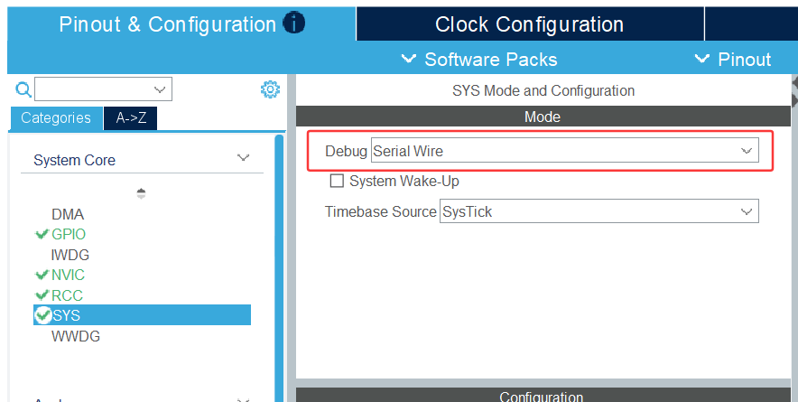

:large_blue_diamond:其次配置系统时钟，选择择HSE外部高速晶振与PLL 倍频配置，最终系统时钟输出 72MHz。

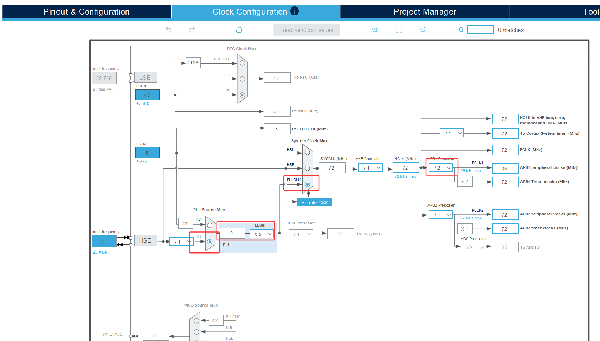

:large_blue_diamond:配置I2C1接入OLED,I2C1 Mode选择I2CI。SCL接PB6、SDA接PB7。

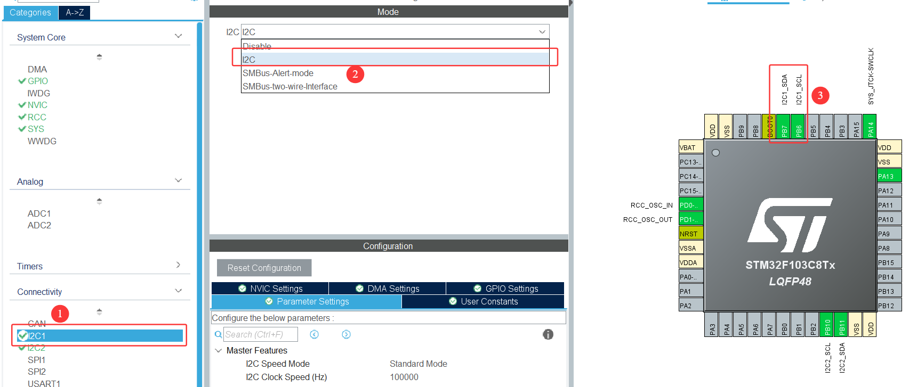

:large_blue_diamond:配置I2C2接入SHT30,SCL接PB10、SDA接PB11。

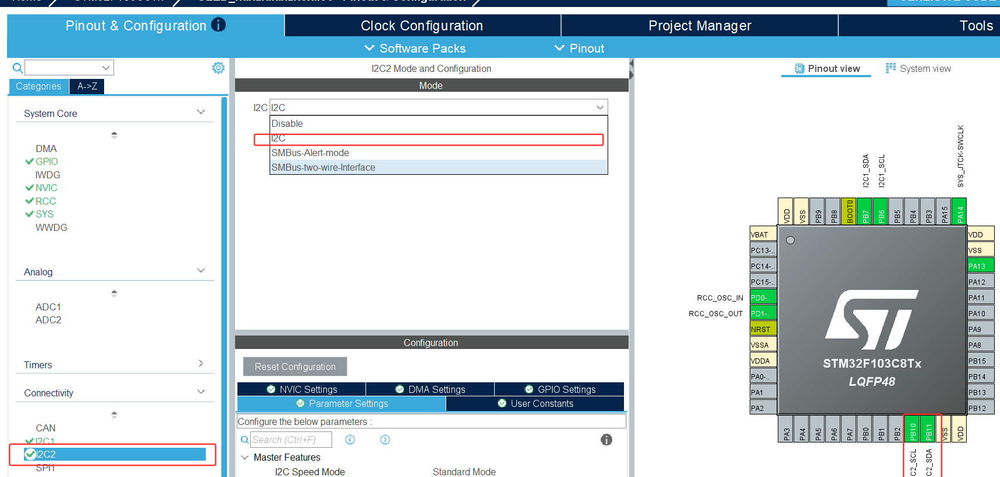

:large_blue_diamond:最后生成工程

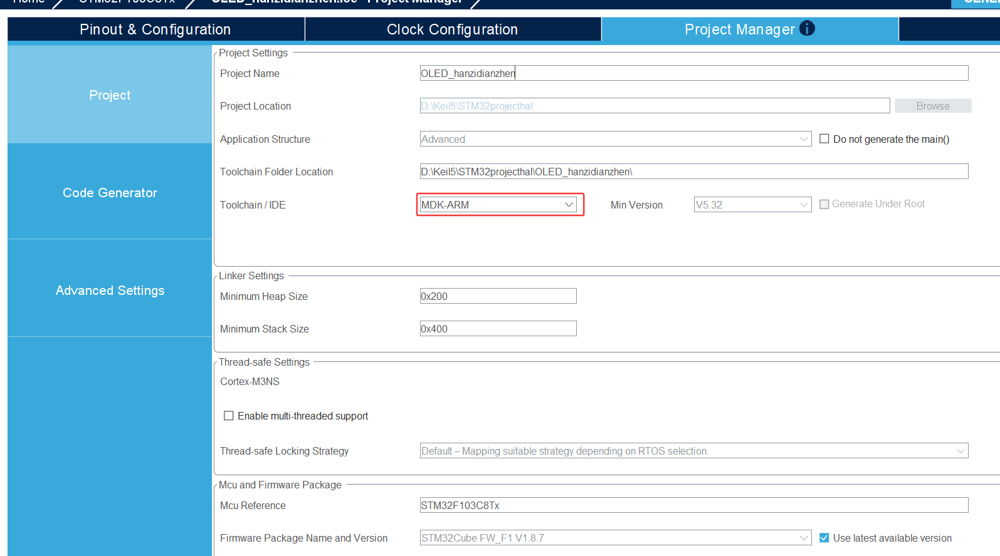

:red_circle:keil工程搭建

:large_blue_diamond:分别添加OLED与SHT30组别

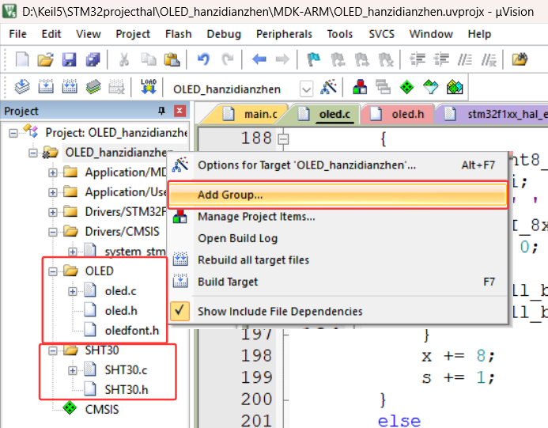

:large_blue_diamond:文件添加完成后，打开魔术棒，在C/C++选项卡的Include Paths里添加头文件路径，保证编译时可以正常找到.h文件，这是我开始忽略的，导致main.c函数调用失败。

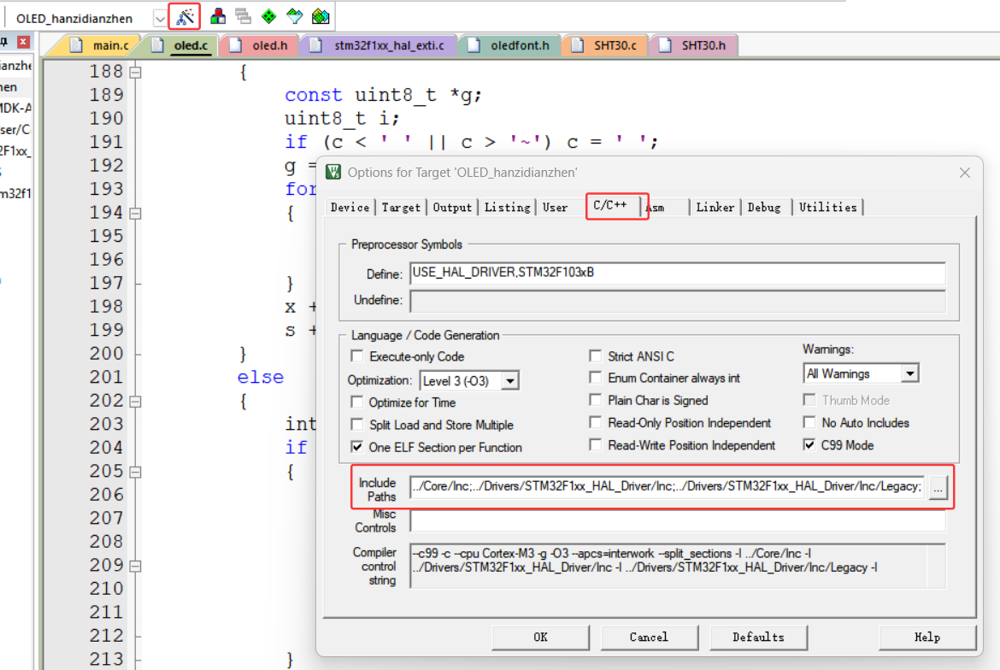

:red_circle:汉字点阵生成

打开PCtoLCD2002取模软件，配置取模参数为阴码、逐行、顺向。在文字输入框内输入姓名学号，生成字模，复制软件输出的点阵数组，粘贴保存到 oled.h 头文件中，供汉字显示函数调用。学号和长字符方法一样不再演示。

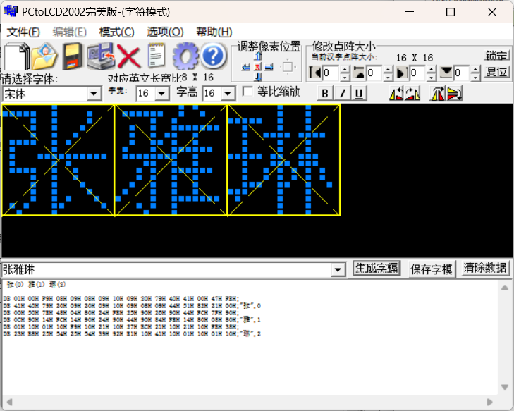

:red_circle:代码编写

:large_blue_diamond:打开生成好的main.c文件，添加OLED和SHT30驱动头文件并初始化,分离为 oled、SHT30两个模块，点阵字模在oled.c 中定义，oled.h做外部声明。

```c
#include "oled.h"
#include "SHT30.h"
```

```c
OLED_Init();       // 初始化SSD1306 OLED
SHT30_Init();      // 初始化SHT30温湿度传感器
```

:large_blue_diamond:将点阵数组姓名学号与函数声明放到oled.h中

```c
#ifndef __OLED_H
#define __OLED_H

#include "main.h"
#include "i2c.h"

#define OLED_I2C_HANDLE hi2c1
#define OLED_ADDR 0x78
#define OLED_COLS 128

void OLED_Init(void);
void OLED_Clear(void);
void OLED_Refresh(void);
void OLED_ShowStr(uint8_t x,uint8_t y,char *str);
void OLED_ShowChinese(uint8_t x,uint8_t y,uint8_t *font);
void OLED_Marquee(uint8_t *text_arr,uint8_t y,uint16_t speed,uint8_t dir);
uint16_t OLED_StrWidth(const char *s);

//汉字&数字点阵
// 张(0) 雅(1) 琳(2)
unsigned char font_zhang[]={
0x01,0x00,0xF9,0x08,0x09,0x08,0x09,0x10,0x09,0x20,0x79,0x40,0x41,0x00,0x47,0xFE,
0x41,0x40,0x79,0x20,0x09,0x20,0x09,0x10,0x09,0x08,0x09,0x44,0x51,0x82,0x21,0x00
};
unsigned char font_ya[]={
0x00,0x50,0x7E,0x48,0x04,0x80,0x24,0xFE,0x25,0x90,0x26,0x90,0x44,0xFC,0x7F,0x90,
0x0C,0x90,0x14,0xFC,0x14,0x90,0x24,0x90,0x44,0x90,0x84,0xFE,0x14,0x80,0x08,0x80
};
unsigned char font_lin[]={
0x01,0x10,0x01,0x10,0xF9,0x10,0x21,0x10,0x27,0xBC,0x21,0x10,0x21,0x10,0xFB,0x38,
0x23,0xB8,0x25,0x54,0x25,0x54,0x39,0x92,0xE1,0x10,0x41,0x10,0x01,0x10,0x01,0x10
};

// 6 3 2 4 0 4 3 1 0 1 0 5
unsigned char font_6[]={
0x00,0x00,0x00,0x18,0x24,0x40,0x40,0x5C,0x62,0x42,0x42,0x42,0x22,0x1C,0x00,0x00
};
unsigned char font_3[]={
0x00,0x00,0x00,0x3C,0x42,0x42,0x02,0x04,0x18,0x04,0x02,0x42,0x42,0x3C,0x00,0x00
};
unsigned char font_2[]={
0x00,0x00,0x00,0x3C,0x42,0x42,0x42,0x02,0x04,0x08,0x10,0x20,0x42,0x7E,0x00,0x00
};
unsigned char font_4[]={
0x00,0x00,0x00,0x04,0x0C,0x0C,0x14,0x24,0x24,0x44,0x7F,0x04,0x04,0x1F,0x00,0x00
};
unsigned char font_0[]={
0x00,0x00,0x00,0x18,0x24,0x42,0x42,0x42,0x42,0x42,0x42,0x42,0x24,0x18,0x00,0x00
};
unsigned char font_1[]={
0x00,0x00,0x00,0x08,0x38,0x08,0x08,0x08,0x08,0x08,0x08,0x08,0x08,0x3E,0x00,0x00
};
unsigned char font_5[]={
0x00,0x00,0x00,0x7E,0x40,0x40,0x40,0x78,0x44,0x02,0x02,0x42,0x44,0x38,0x00,0x00
};

// 滚动整句点阵数组：H e l l o ，欢 迎 来 到 重 庆 交 通 大 学 物 联 网 2 0 5 实 训 室 ！
extern uint8_t marquee_font[];

#endif
```

:large_blue_diamond:在oled.c末尾添加长字符数组uint8_t marquee_font[]“Hello，欢迎来到重庆交通大学物联网205实训室！”，编码在PCtoLCD2002取模可得到。

:large_blue_diamond:在oled.c中添加汉字绘制函数

```c
// 16*16汉字显示函数
void OLED_ShowChinese(uint8_t x,uint8_t y,uint8_t *font)
{
    uint8_t i;
    for(i=0;i<16;i++)
    {
        OLED_DrawByte(x+i, y, font[i]);
        OLED_DrawByte(x+i, y+1, font[i+16]);
    }
}
```

:large_blue_diamond:显示学号姓名

```c
// 显示学号
OLED_ShowChinese(8,0,font_6);
OLED_ShowChinese(24,0,font_3);
OLED_ShowChinese(40,0,font_2);
OLED_ShowChinese(56,0,font_4);
OLED_ShowChinese(72,0,font_0);
OLED_ShowChinese(88,0,font_4);
OLED_ShowChinese(104,0,font_3);
OLED_ShowChinese(120,0,font_1);
// 显示姓名：张雅琳
OLED_ShowChinese(32, 2, font_zhang);
OLED_ShowChinese(48, 2, font_ya);
OLED_ShowChinese(64, 2, font_lin);
OLED_Refresh();
```

OLED_ShowChinese(x,y,font)为汉字绘制函数。

:large_blue_diamond:读取显示温湿度

```c
static void ShowTH(void)
{
    float temp = 0.0f, humi = 0.0f;
    char buf[24];
    int t, h;

    OLED_Clear();
    if (SHT30_ReadData(&temp, &humi) == 0)
    {
        t = (int)(temp * 10.0f);
        h = (int)(humi * 10.0f);

        sprintf(buf, "Temp:%c%d.%dC",
                t < 0 ? '-' : ' ', t < 0 ? (-t) / 10 : t / 10, t < 0 ? (-t) % 10 : t % 10);
        ShowCentered(1, buf);

        sprintf(buf, "Humi:%d.%d%%", h / 10, h % 10);
        ShowCentered(3, buf);
    }
    else
    {
        ShowCentered(1, "Temp:--.-C");
        ShowCentered(3, "Humi:--.-%");
    }
    OLED_Refresh();
}
```

:large_blue_diamond:滑动显示长字符，调用SSD1306硬件滚动功能

```c
OLED_Clear();
OLED_ShowChinese(0,4,marquee_font);
OLED_HardwareScroll_Left(4,4);  
HAL_Delay(3000);
OLED_StopScroll();
```

:large_blue_diamond:while主循环添加延时

```c
while (1)
{
    ShowIDName();
    HAL_Delay(2000);
    ShowTH();
    HAL_Delay(2000);
    OLED_Clear();
    OLED_ShowChinese(0,4,marquee_font);
    OLED_HardwareScroll_Left(4,4);
    HAL_Delay(3000);
    OLED_StopScroll();
}
```

总的来说，点阵绘制函数实现学号姓名静态显示，SHT30读取函数完成温湿度采集展示，SSD1306滑动指令实现文本滑动效果。

OLED屏幕显示实验现象如下

:large_blue_diamond:显示姓名学号

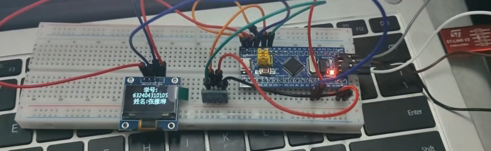

:large_blue_diamond:显示温度湿度

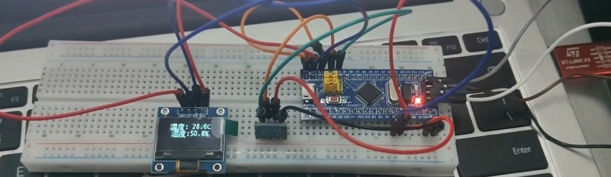

:large_blue_diamond:滑动显示长字符

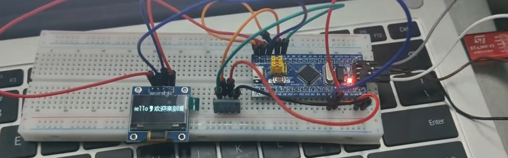

## 3 U8g2库的OLED图形界面移植与波形问题

#### 3.1U8g2库裁剪移植

STM32CubeMX其他和前文一致，接下来我主要讲U8G2移植和keil工程如何配置。

须先下载U8g2库，这里提供下载链接https://pan.baidu.com/s/14x-oVMYRPTK5f11myCphgw?pwd=a98e 

对于该工程，我们只保留SSD1306 I2C相关驱动文件

:large_blue_diamond:OLED驱动为ssd1306，使用u8x8_ssd1306_128x64_noname.c这个驱动的屏幕分辨率，其它的屏幕驱动和分辨率的文件可以删掉。

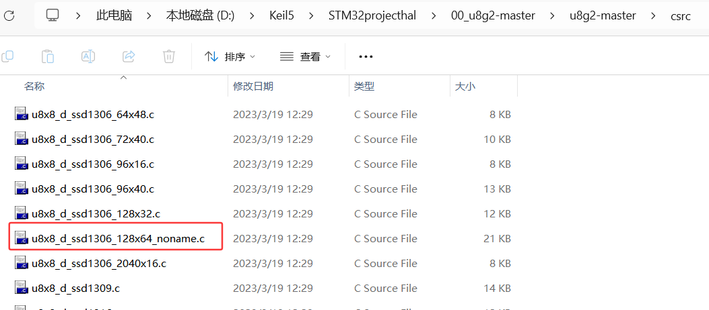

:large_blue_diamond:该初始化接口，完成屏幕驱动、I2C回调与显存缓冲区分配。

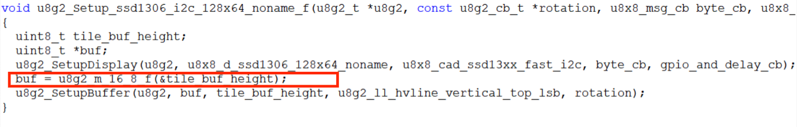

:large_blue_diamond:将精简后的U8g2添加到keil工程

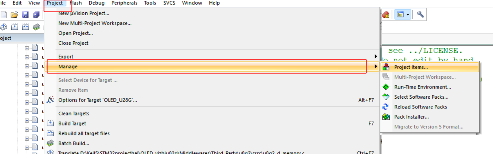

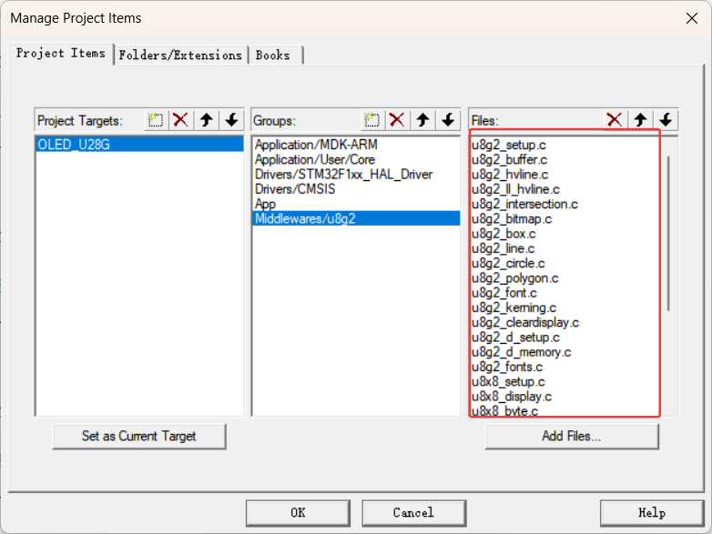

:large_blue_diamond:添加底层回调函数

```c
 MX_GPIO_Init();
#if (OLED_USE_SW_I2C == 0)
  MX_I2C1_Init();
#endif
```

:large_blue_diamond:完成U8g2初始化

```c
//U8g2初始化
void App_Init(void)
{
  u8g2_Setup_ssd1306_i2c_128x64_noname_f(&u8g2, U8G2_R0, u8x8_byte_hw_i2c, u8x8_gpio_and_delay_hal);
  u8g2_InitDisplay(&u8g2);
  u8g2_SetPowerSave(&u8g2, 0);
  UI_DemoTest();
}
```

:large_blue_diamond:添加U8g2轮询任务，依靠系统定时器分时切换显示界面

```c
//轮询任务
void App_Task(void)
{
  static uint32_t last_t = 0;
  uint32_t now = HAL_GetTick();
  if(now - last_t > 2500)
  {
    last_t = now;
    static uint8_t state = 0;
    state ++;
    if(state >=4) state =0;
    switch(state)
    {
      case 0: UI_DemoTest(); break;
      case 1: UI_ShowIDName(); break;
      case 2: UI_ScrollText(); break;
      case 3: UI_AvatarAnim(now); break;
    }
  }
}
```

:large_blue_diamond:demo图形测试

```c
// Demo基础图形测试
void UI_DemoTest(void)
{
  u8g2_ClearBuffer(&u8g2);
  u8g2_DrawStr(&u8g2,0,20,"U8g2 Demo");
  u8g2_DrawFrame(&u8g2,10,30,80,20);
  u8g2_SendBuffer(&u8g2);
}
```

:large_blue_diamond:文字滑动设置

```c
void UI_ScrollText(void)
{
  u8g2_ClearBuffer(&u8g2);
  u8g2_DrawStr(&u8g2,0,30,"Hello CQJTU");
  u8g2_SendBuffer(&u8g2);
  u8g2_StartScroll(&u8g2,0,0,127,7,1,0);
}
```

:large_blue_diamond:图像动态平移设置

```c
void UI_AvatarAnim(uint32_t tick)
{
  u8g2_ClearBuffer(&u8g2);
  uint8_t x = (tick / 200) % 40;
  u8g2_DrawXBMP(&u8g2,x,10,32,32,avatar_img);
  u8g2_SendBuffer(&u8g2);
}
```

U82G源码移植任务实验现象如下

:large_blue_diamond:U8g2 demo例程

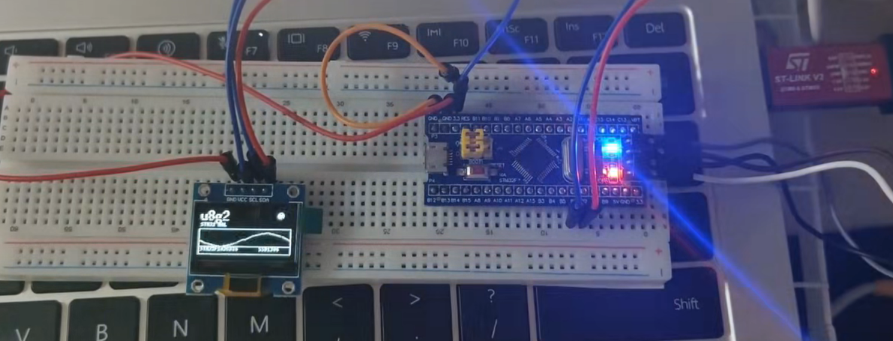

:large_blue_diamond:显示学号名字

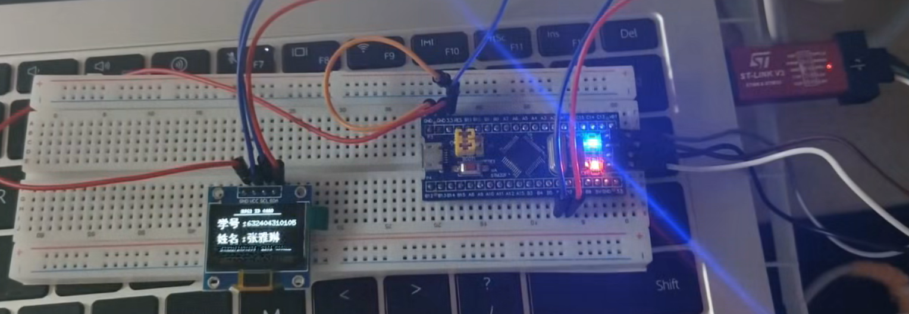

:large_blue_diamond:显示上下左右滑动

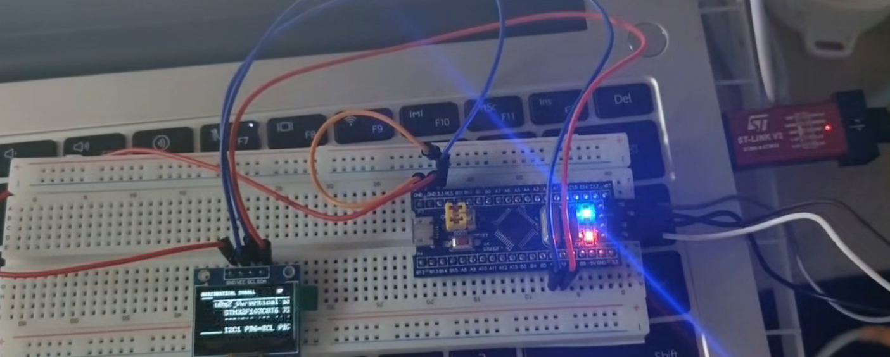

:large_blue_diamond:动态显示图案

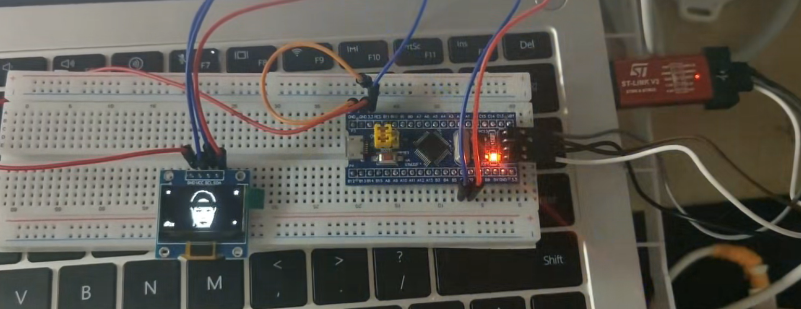

### 3.2波形可否采集

如下图所示，直接用Keil虚拟逻辑分析仪观察SDA引脚时，波形是一条直线，没有出现I2C起始位、数据位、应答位等时序。

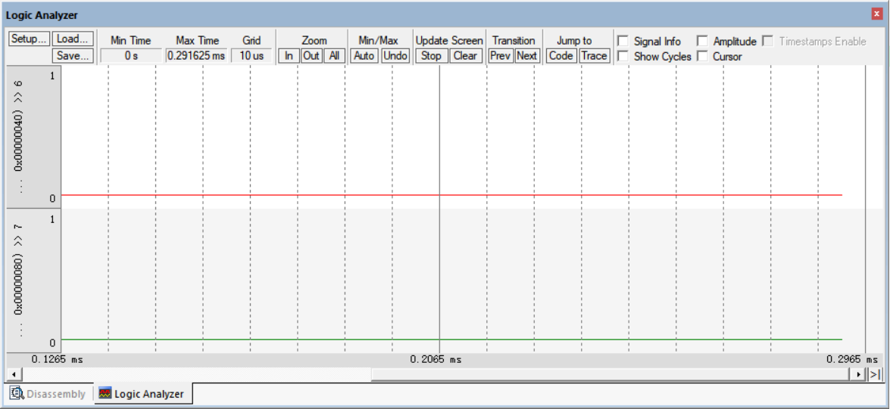

是因为我们使用的是STM32中I2C外设，I2C独立输出电平，Keil仿真的虚拟逻辑分析仪无法捕获硬件外设自动产生的引脚电平变化，它只能捕捉软件控制GPIO翻转的信号。

想要观测真实I2C通信，我们可以使用USB逻辑分析仪抓取实物引脚波形并自动解码，也可以使用示波器观测电平，或者在I2C发送回调中增加串口打印，输出传输的字节数据，或者定时器输入捕获采集 SDA、SCL，串口上传还原波形等方法。

```
SCL  ┌─┐ ┌─┐ ┌─┐ ┌─┐ ┌─┐ ┌─┐ ┌─┐ ┌─┐ ┌─┐
   ──┘ └─┘ └─┘ └─┘ └─┘ └─┘ └─┘ └─┘ └─┘ └──
SDA  ──┐  ┌──┬──┬──┬──┬──┬──┬──┬──┬──┬──
       └──┘  A6 A5 A4 A3 A2 A1 A0 W  ACK
```


## 4 总结

本实验我掌握了I2C作为通信协议，用两根线让多个芯片互相传递数据。SCL 时钟线输出时钟节拍，SDA 数据线用来传输数据，可以双向收发。本实验我用I2C1接OLED屏幕，I2C2接SHT30温湿度传感器。其次是汉字点阵的显示原理，借助PCtoLCD2002取模软件，生成学号、姓名和长字符对应的点阵数组。最终完成的实验效果分别是在OLED屏幕展示学号和姓名;读取SHT30原始数据，换算出温湿度并实时显示；用SSD1306的硬件滚动寄存器，用硬件模式滑动展示长字符。该滑动方式是屏幕内部控制器完成的，不用CPU反复刷屏，能减轻单片机的运算负担。

其次学到了U8g2图形库的HAL库移植。拿到完整的U8g2源码后需要做代码裁剪，删掉其他屏幕的驱动文件，只保留SSD1306部分。还要自己编写I2C发送、延时的底层回调函数，把U8g2和STM32的HAL库对接起来。U8g2会先在单片机内存的缓冲区完成所有绘图，再一次性把整屏数据发给OLED。我依次跑通了Demo例程、学号姓名显示、文字多方向滑动，还导入头像点阵，不断修改绘制坐标做出图案平移的动态效果。对比自己写驱动，U8g2封装好了接口，提高了开发效率。

可以发现，用Keil虚拟逻辑分析仪去抓I2C的SDA引脚，出来是一条平直的电平线，看不到 I2C 协议里的波形。了解到这个仿真工具只能识别代码翻转GPIO产生的电平变化，芯片片上硬件I2C外设自动输出的时序，它是抓不到的。想要看真实的I2C信号，可以用USB逻辑分析仪或者数字示波器直接测开发板实物引脚；也可以在 I2C 发送回调函数里加上串口打印，把发送的字节数据打印出来，验证通信问题。

对比这两种OLED开发方式，自己写底层驱动可以更深层次了解SSD1306、点阵、硬件滚动这些底层逻辑。U8g2把很多底层细节封装了起来，需要先处理源码裁剪、底层接口适配这些移植工作。这次实验底层开发和开源库移植两种思路，为我之后开发项目提供了新思路新方法。